# cad2urdf

Convert CAD assemblies into ROS 2-ready URDF packages.

[](https://github.com/boelnasr/CAD_TO_URDF/actions/workflows/ci.yml) [](#development) [](#install) [](#license) [](#status--roadmap)

`cad2urdf` takes mesh files (STL or OBJ) plus a YAML joint description, or a
STEP/IGES assembly (`.stp`/`.step`/`.igs`/`.iges`, via the `[step]` extra) whose
named parts, poses, and conservative joint hypotheses are read directly. It
emits a complete ROS 2 ament_cmake package — URDF + meshes
+ `package.xml` + `CMakeLists.txt` + `launch/display.launch.py` + `rviz/display.rviz`
— ready to drop into a workspace and view in RViz. Inertia is auto-computed
from each mesh using a user-supplied material density, validated by the user's
[ManipulaPy](https://github.com/boelnasr/ManipulaPy) URDF parser.

---

## Status & Roadmap

| Version | Status | Scope |
|---|---|---|
| **v1.0.0** (current) | shipped | STEP + IGES assembly import across CLI, GUI, and MCP, with conservative geometry-based inference of continuous/prismatic joints and a safe fixed fallback |
| v0.2.0a0 | shipped | PyQt6/VTK GUI, end-to-end MCP control, and STEP assembly import |
| v0.1.0a0 | shipped | CLI core: STL/OBJ in, full ROS package out, ManipulaPy validation gate |
| v2.x | planned | Planar-joint inference and optional natural-language priors |
| v3.x | planned | ML-based kinematic skeleton extraction (URDFormer-class) from raw meshes |
| v-future | planned | xacro / SDF / MJCF emitters; macOS + Windows packaging |

See the [v1.0 implementation plan](docs/superpowers/plans/2026-06-14-cad-to-urdf-v1.0-iges-joint-inference.md),
the historical [STEP assembly design](docs/superpowers/specs/2026-06-13-step-assembly-import-design.md),
and the [changelog](CHANGELOG.md).

---

## Install

### Pip-only path (recommended for v1.0.0)

```bash
python3.10 -m venv .venv
source .venv/bin/activate
pip install -e ".[dev]"
```

Targets Python 3.10+ (matches Ubuntu 22.04 / ROS 2 Humble baseline). STL and OBJ
mesh inputs are fully supported out of the box.

### CAD assembly import extra (STEP + IGES)

```bash
pip install -e ".[step]"
```

Adds [`cadquery-ocp`](https://pypi.org/project/cadquery-ocp/) — the
pip-installable OCCT (OpenCASCADE) binding — enabling `.stp` / `.step` and
`.iges` / `.igs` assembly import in the CLI, GUI, and MCP server. The extra
keeps its historical `[step]` name; IGES does not need another dependency.
Each named part becomes a link (with its tessellated mesh and pose), while
sub-assembly nodes become meshless frame links. Joint inference is advisory:
review the generated types, axes, and limits in the Joint Editor before using
the robot. OCP is lazy-imported, so the core package still runs without it.

### Conda path

```bash
conda env create -f environment.yml
conda activate cad2urdf
```

The environment uses Conda for Python and installs this project with its
`[step]` extra, so the runtime still uses the verified `cadquery-ocp` binding.
`pythonocc-core` exposes a different Python import namespace and is not a
drop-in replacement for this code.

### ManipulaPy validation extra

```bash
pip install -e ".[dev,urdf-io]"
```

Adds the user's [ManipulaPy](https://github.com/boelnasr/ManipulaPy) library
(>= 1.4.2; its core deps are numpy, scipy, matplotlib, numba and pillow), enabling
the post-emit URDF validation gate. Older releases printed a banner to stdout on
import, which breaks the MCP server's JSON-RPC stream. Without this extra, the
CLI's `--no-validate` flag is required (or you get a clean "ManipulaPy not
installed" message and continue).

### ROS 2 Humble PYTHONPATH gotcha

If your shell sources ROS 2 Humble, its `PYTHONPATH` leaks into the venv and
crashes `pytest` collection (the `launch_testing` plugin imports `lark` which
isn't in the venv). Strip before testing:

```bash
unset PYTHONPATH AMENT_PREFIX_PATH
pytest
```

---

## Quick Start

```bash
# 1. Make two unit cubes (or use your own STL/OBJ files)
python -c "import trimesh; trimesh.creation.box(extents=(1,1,1)).export('cube_a.stl')"
python -c "import trimesh; trimesh.creation.box(extents=(1,1,1)).export('cube_b.stl')"

# 2. Describe the joints
cat > joints.yaml <<'EOF'
robot_name: two_cubes
base_link: cube_a
joints:
  - name: weld
    type: fixed
    parent: cube_a
    child: cube_b
    origin:
      xyz: [2.0, 0.0, 0.0]
      rpy: [0, 0, 0]
materials:
  cube_a: aluminum_6061
  cube_b: steel_1018
EOF

# 3. Convert
cad2urdf cube_a.stl cube_b.stl \
  --joints joints.yaml \
  -o two_cubes_description \
  --package-name two_cubes_description \
  --no-validate

# 4. Result
tree two_cubes_description/
# two_cubes_description/
# ├── CMakeLists.txt
# ├── launch/
# │   └── display.launch.py
# ├── meshes/
# │   ├── collision/{cube_a.stl, cube_b.stl}
# │   └── visual/{cube_a.stl, cube_b.stl}
# ├── package.xml
# ├── rviz/
# │   └── display.rviz
# └── urdf/
#     └── two_cubes.urdf
```

To view in RViz, drop the package into a ROS 2 workspace and run:

```bash
ros2 launch two_cubes_description display.launch.py
```

---

## Examples

Two complete, ready-to-inspect examples ship in [`examples/`](examples/). Each folder
contains the **source meshes** plus the **fully generated ROS 2 package** (URDF +
meshes + `package.xml` + `CMakeLists.txt` + launch + rviz), so you can either browse
the output directly or regenerate it yourself.

| Example | Links | Joints | What it shows |
|---|---|---|---|
| [`examples/two_cubes/`](examples/two_cubes/) | 2 | 1 × `fixed` | Smallest end-to-end run: two unit cubes welded together. Matches the Quick Start above. |
| [`examples/iiwa14/`](examples/iiwa14/) | 8 | 7 × `revolute` | KUKA LBR iiwa14 — a full 7-DOF serial arm with per-link inertia baked from real meshes. |

### `two_cubes` — minimal weld

```bash
cd examples/two_cubes
# Source meshes: cube_a.stl, cube_b.stl
# Pre-generated package: two_cubes_description/
ros2 launch two_cubes_description/launch/display.launch.py   # view in RViz
```

To regenerate from scratch, use the `joints.yaml` from the [Quick Start](#quick-start)
and run `cad2urdf cube_a.stl cube_b.stl --joints joints.yaml -o two_cubes_description --no-validate`.

### `iiwa14` — 7-DOF KUKA arm

The classic LBR iiwa14: a base (`link_0`) and seven revolute joints driving links
`link_1`–`link_7`. Source meshes live in [`examples/iiwa14/meshes/`](examples/iiwa14/meshes/);
the generated package is [`examples/iiwa14/iiwa14_description/`](examples/iiwa14/iiwa14_description/).

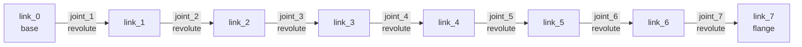

```bash
cd examples/iiwa14
ros2 launch iiwa14_description/launch/display.launch.py       # view the arm in RViz
```

---

## GUI (desktop app)

A PyQt6 + VTK desktop app for authoring robots visually — import meshes, build
the kinematic tree, edit joints, and export a ROS 2 package, all with a live 3D
viewport.

```bash
pip install -e ".[gui]"      # PyQt6 + PyVista/VTK
cad2urdf-gui
```

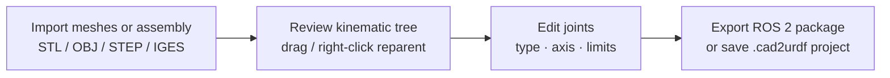

- **Import** one mesh per moving part (`File → Import Meshes`); the first becomes
  the base link and the rest are attached, then you reshape the tree.
- **Import CAD assembly** (`File → Import CAD assembly`, needs the `[step]`
  extra) — load one STEP or IGES file. Named parts, assembly poses, and
  conservative joint hypotheses are imported together.
- **Link Tree** dock — reparent links (right-click or drag) into a chain.
- **Joint Editor** dock — review inferred joints and set each joint's type,
  axis, origin, and limits. Inference is a starting point, not a CAD constraint
  solver; confirm it against the intended mechanism.
- **3D viewport** — a studio-rendered view that places every link at its
  forward-kinematic world pose (the assembled robot, matching the exported URDF /
  RViz), with PBR metallic shading, soft lighting + ground shadow, and a
  contrasting highlight on the selected link. Click a link to select it.
- **Export** a full ROS 2 ament package (`Export → Export ROS Package`) or save a
  `.cad2urdf` project.

> **CAD project assets.** Saving a project copies all available referenced
> meshes into a `<project-name>_assets` directory beside the `.cad2urdf` file.
> If a folder with that name already exists and cad2urdf did not create it,
> saving stops with an error instead of replacing it.
> Keep that directory with the project when moving or sharing it; paths inside
> the project are resolved relative to the project file when it is reopened.

> **Inputs.** The GUI imports `.stl` / `.obj` meshes (one file per link) and, with
> the `[step]` extra installed, full STEP (`.step` / `.stp`) and IGES (`.iges` /
> `.igs`) assemblies. Importing an assembly replaces the current document and
> clears undo/redo history.

Running headless (no display)? See the offscreen env vars under
[Headless / CI use](#headless--ci-use).

---

## MCP Server (drive the GUI from Claude)

`cad2urdf` ships an MCP server that **launches the GUI and lets an MCP client
(e.g. Claude) operate it end-to-end** — import meshes, edit the kinematic tree,
validate, export a ROS package, and screenshot the live window.

```bash
pip install -e ".[gui,mcp]"       # MCP-controlled GUI for STL/OBJ workflows
pip install -e ".[gui,mcp,step]"  # also enables STEP/IGES import_cad
```

Register it with your MCP client (Claude Code example):

```bash
claude mcp add cad2urdf -- cad2urdf-mcp
```

The server spawns the GUI on first use over a private Unix-domain socket (no
network exposure), then proxies high-level commands onto the GUI. CAD parsing
and inference run in a background worker while control requests retain FIFO
ordering.
The socket lives in an owner-only (`0o700`) temp directory, which is the access
control for the unauthenticated control channel:

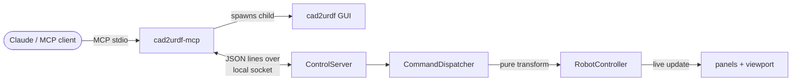

Every edit runs through the same `RobotController` a human uses, so changes render
live and land on the undo/redo stack. CAD import is the fresh-document exception:
it replaces the current robot and clears undo/redo history. Available tools:

| Group | Tools |
|---|---|
| Introspect | `get_robot`, `list_materials`, `get_history`, `gui_status` |
| Build | `import_meshes`, `import_cad`, `set_base_link`, `rename_link`, `remove_link`, `set_link_material` |
| Joints | `update_joint` (type / axis / origin / limits / reparent) |
| Project / export | `save_project`, `open_project`, `validate`, `export_package` |
| Control | `undo`, `redo`, `screenshot` (on-demand PNG) |

A robot is a kinematic **tree**: each non-base link has exactly one incoming
joint. Joints are created by `import_meshes`, removed by `remove_link`, and
restructured by `update_joint(..., parent=...)`.

### Headless / CI use

The MCP server launches the GUI expecting a display (the human can watch it). To
run it headless (no X server), export both of these before starting so the GUI
and its VTK/PyVista viewport fall back to offscreen rendering:

```bash
export QT_QPA_PLATFORM=offscreen
export PYVISTA_OFF_SCREEN=true
```

---

## CLI Reference

```
cad2urdf <inputs>... -o OUT_DIR [--joints CONFIG.yaml] [options]
```

| Flag | Purpose |
|---|---|
| `<inputs>...` | One or more STL or OBJ files (each file's stem becomes a link name), **or** one STEP/IGES assembly (`.stp`, `.step`, `.igs`, `.iges`; needs the `[step]` extra). CAD assemblies cannot be mixed with other inputs. |
| `-o, --out PATH` | Output directory. Will be created if missing. If pre-existing, **never** deleted on rollback (we only clean dirs we created). |
| `--joints PATH` | YAML config defining joint topology, axes, limits, and per-link materials (required for STL/OBJ; ignored for CAD assemblies). |
| `--robot-name NAME` | Override `robot_name` from YAML, or the CAD filename stem. |
| `--package-name NAME` | ROS package name. Must match `^[a-z][a-z0-9_]*$`. Defaults to `out_dir.name`. |
| `--maintainer NAME` | Maintainer name written into `package.xml` (XML-escaped). Default `cad2urdf-user`. |
| `--maintainer-email ADDR` | Maintainer email (XML-escaped via `quoteattr`). Default `user@example.com`. |
| `--no-validate` | Skip the ManipulaPy post-emit validation gate. Required if `manipulapy` isn't installed. |
| `-v, -vv` | Increase log verbosity (info, debug). |

Exit codes: `0` success, `2` error (config invalid, mesh load failed, joint structure invalid, write failed). Errors trigger automatic rollback of the output directory if we created it; pre-existing user directories are preserved.

For example, import an assembly without a joints YAML:

```bash
cad2urdf robot.iges -o robot_description --no-validate
```

The CAD path infers candidate joints from geometry, selects a
maximum-confidence forest among sibling-body hypotheses, roots it with a
deterministic BFS, and emits the package. The emitted ROS package is not a GUI
project. If you need to review or edit the inferred tree, import the original
CAD assembly through the GUI first, then export from that session.

---

## Joints YAML Schema

```yaml
# Required: top-level robot identity.
robot_name: my_arm                 # str, becomes the URDF <robot name=...>.
base_link: base                    # str, must be one of the input mesh stems.

# Required: list of joints. Each joint connects two links by name (= mesh stem).
joints:
  - name: shoulder                 # str, unique per robot.
    type: revolute                 # one of: revolute, prismatic, fixed, continuous, floating, planar
    parent: base                   # str, must be in the inputs.
    child: link_1                  # str, must be in the inputs and != parent.
    axis: [0.0, 0.0, 1.0]          # 3-element list of finite floats (auto-normalized).
    origin:
      xyz: [0.0, 0.0, 0.1]         # 3-element list of finite floats (meters).
      rpy: [0.0, 0.0, 0.0]         # 3-element list of finite floats (radians, fixed-axis).
    limits:                        # required for revolute/prismatic; rejected if missing.
      lower: -3.14                 # finite float.
      upper:  3.14                 # finite float, >= lower.
      effort: 100.0                # finite float, Nm or N.
      velocity: 2.0                # finite float, rad/s or m/s.

# Optional: per-link material override (default: aluminum_6061).
materials:
  base: aluminum_6061
  link_1: steel_1018
```

Validation enforces structural correctness (top-level mapping, required string fields, axis length=3, origin xyz/rpy length=3, materials dict[str,str]) and rejects non-finite numerics (`.nan`, `.inf`). Errors point at the offending YAML key with the file path and joint index.

---

## Materials

The default material table ships at [`config/materials.json`](config/materials.json) with 7 presets:

| Name | Density (kg/m³) | Notes |
|---|---|---|
| `aluminum_6061` | 2700 | Default if no material specified. Light, common for robotics chassis. |
| `steel_1018` | 7850 | Mild steel; cheap, heavy. |
| `stainless_304` | 8000 | Slightly denser than 1018; corrosion-resistant. |
| `titanium` | 4500 | Aerospace-grade; expensive but strong. |
| `pla` | 1240 | Most common 3D-print filament. |
| `abs` | 1050 | Tougher 3D-print plastic; less common. |
| `carbon_fiber` | 1600 | Composite; treated as bulk density (anisotropy ignored). |

Each entry also defines an RGBA color used in the URDF `<material>` block, surfaced in RViz / Gazebo.

To use a custom material, add it to `config/materials.json` (the loader caches the result per process via `@cache`). The returned table is wrapped in `MappingProxyType` so callers can't accidentally corrupt the global table.

---

## Pipeline Architecture

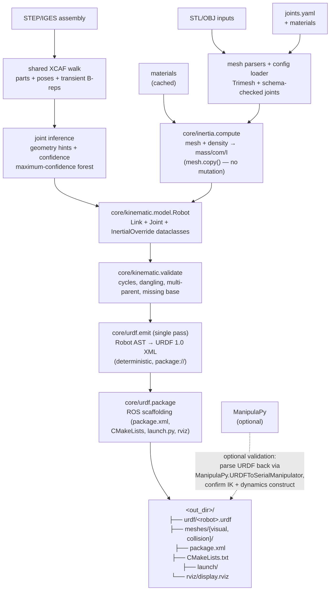

**Key invariants:**

- The `Robot` dataclass is the **single source of truth** between parsing and emission. All transformations operate on it.
- OCP B-rep handles are transient inference inputs. They are cleared before the
  `Robot` is built and never enter project JSON or MCP payloads.
- `core/` has zero `Qt` or `VTK` imports (enforced by file structure; the GUI lives entirely in the separate `gui/` package and builds on `core/`).
- URDF mesh paths are always `package://<pkg>/<rel>` — absolute paths and `..` segments are rejected at the boundary.
- `package_name` is validated against ROS naming rules (`^[a-z][a-z0-9_]*$`); `urdf_relpath` components must match `^[a-zA-Z0-9_.-]+$` to prevent template injection into generated launch.py.
- Maintainer fields are XML-escaped via `xml.sax.saxutils.escape` and `quoteattr`.

---

## Algorithms

The non-trivial steps behind the pipeline, each linked to its source.

### Advisory CAD joint inference — `core/extract/joint_infer.py`

For STEP/IGES imports, the shared CAF parser supplies each leaf body's transient
B-rep shape. Geometry probes compare sibling bodies in their common assembly
frame and attach a mate hint, axis, limits when trustworthy, and confidence to
candidate edges. Only hints at or above the default `0.6` confidence threshold
can produce a moving joint:

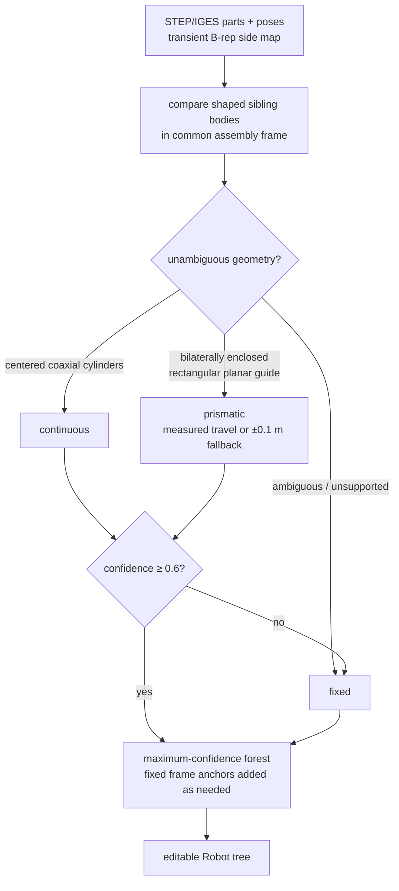

This is deliberately conservative. Off-origin coaxial axes, conflicting
cylinder axes, one-sided or L-shaped contacts, oblique/nonrectangular guides,
and multi-parent XCAF instances stay fixed. The result is an editable
hypothesis, not proof of the mechanism's degrees of freedom: confirm joint
type, parent/child relationship, axis, origin, and limits before simulation or
hardware use.

### Inertia computation — `core/inertia/compute.py`

Mass, center of mass, and the 3×3 inertia tensor are derived from the mesh and a
material density. Non-watertight meshes (common in exported CAD) fall back to
their convex hull; a degenerate hull falls back to zero mass. Any
`InertialOverride` field the user set wins over the computed value.

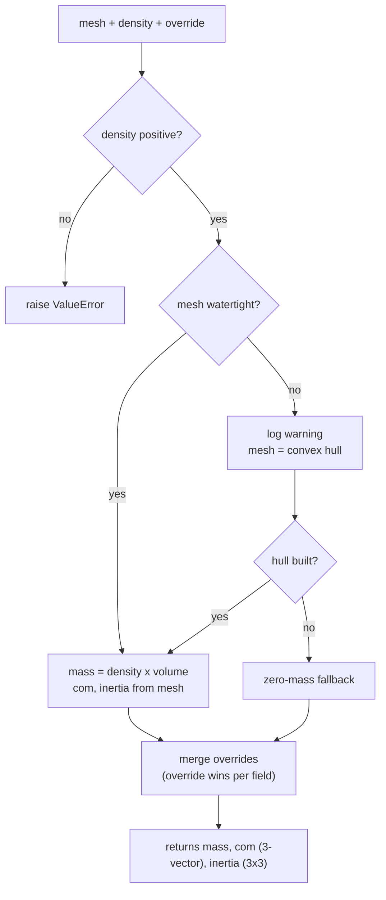

### Forward kinematics — `core/kinematic/tree.py: link_world_transforms`

Each link's world pose is the product of joint origins from the base down the
tree (`world[child] = world[parent] @ joint.origin`), computed by a breadth-first
walk from `base_link` (identity). Orphan links default to identity. This is what
places every mesh in the viewport and the exported URDF.

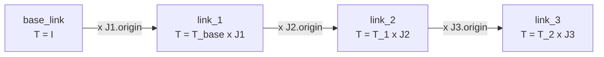

### Tree re-rooting — `core/kinematic/tree.py: set_base_link`

To re-root the tree at a new base, the joints on the path from the new base up to
the old base are reversed: parent and child swap and the 4×4 origin is inverted.
All other joints are untouched.

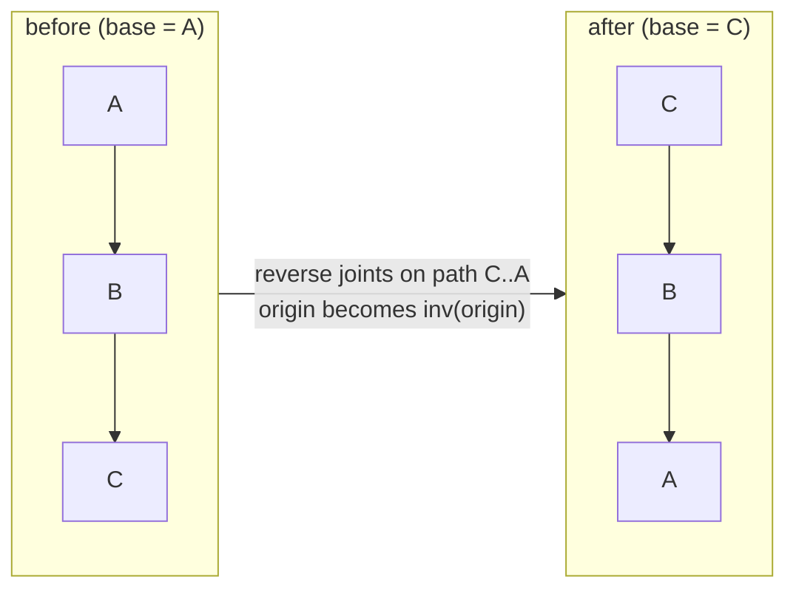

### Spanning-tree extraction — `core/extract/spanning_tree.py`

A CAD assembly is a graph that may contain loops. A breadth-first walk from the
base keeps the first edge that reaches each new node and drops loop-closing
edges. An edge traversed "backwards" is re-directed away from the base — its
relative pose is inverted and its axis negated. Nodes unreachable from the base
raise `SpanningTreeError`. This is the final graph-to-tree step for STEP and
IGES imports.

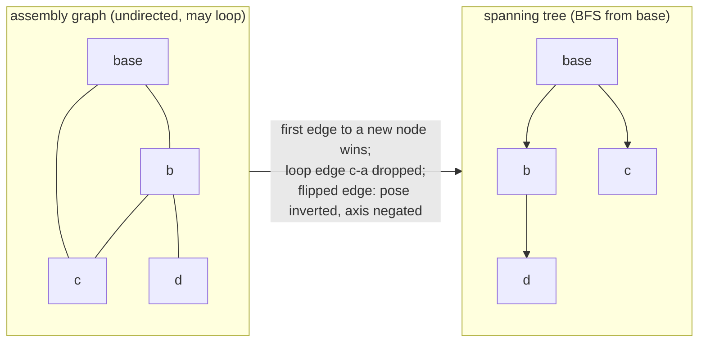

### Kinematic validation — `core/kinematic/validate.py`

A Robot AST is checked by four independent passes; the result is a flat list of
issues (empty means valid).

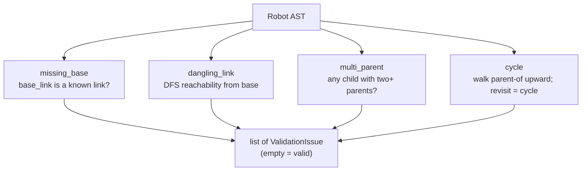

### Origin transform conversion — `core/config/loader.py` & `core/urdf/emit.py`

URDF expresses joint placement as `xyz` + fixed-axis roll-pitch-yaw; internally a
joint carries a 4×4 homogeneous transform. The two conversions round-trip; the
decomposition handles the gimbal-lock case where `cos(pitch) ≈ 0`.

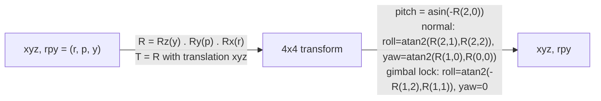

---

## Project File Format (`.cad2urdf`)

The CLI is stateless, but `core/project/save.py` exposes `save_project(robot, path)` and `load_project(path)` for tools that want to round-trip a `Robot` AST as JSON:

```json
{
  "schema_version": 1,
  "name": "my_arm",
  "base_link": "base",
  "links":  [ {"name": "...", "visual_mesh_path": "...", ...} ],
  "joints": [ {"name": "...", "type": "revolute", ...} ]
}
```

Schema migrations live in a `_MIGRATIONS: dict[(int,int), Callable]` registry — empty in v1, populated when `SCHEMA_VERSION` bumps. Loading an unsupported version raises with a pointer to the registry file.

> **Schema-v1 CAD assets.** The JSON stores mesh paths rather than embedding
> binary mesh data. On save, available meshes are copied into a sibling
> `<project-name>_assets` directory and recorded as project-relative paths, so
> CAD imports remain reopenable after the GUI's temporary import directory is
> cleaned up. Move or share the JSON and its asset directory together.

---

## Development

### Run the test suite

```bash
unset PYTHONPATH AMENT_PREFIX_PATH    # strip ROS leakage
pytest                                # 435 passing unit + integration + GUI tests
pytest -m slow                        # ManipulaPy validation tests (need [urdf-io])
```

### Type-check

```bash
mypy                                  # strict mode on src/cad2urdf/{core,gui,mcp}/
```

`gui/` is checked with a few error codes relaxed for PyQt6 stub noise (see the
`[[tool.mypy.overrides]]` in `pyproject.toml`). CI enforces this gate.

### Continuous integration

[GitHub Actions](.github/workflows/ci.yml) runs on every push to `main` and every
pull request. A dedicated **unit tests** job runs `pytest tests/unit`, providing
an explicit unit-test status check. The full CI job separately enforces **ruff**
(lint), **mypy** (strict), and the complete unit + integration + GUI suite. It
installs the `[dev,gui,step,mcp]` extras so the STEP/IGES (OCP) and Qt/VTK paths
are exercised, and runs the GUI/CAD tests headless under `xvfb` with
`QT_QPA_PLATFORM=offscreen` + `PYVISTA_OFF_SCREEN=true`.
Generated STEP and IGES fixtures exercise both CAD readers and the inference
path without committing large binary fixtures.

### Project layout

```
cad2urdf/
├── src/cad2urdf/
│   ├── core/                         # zero Qt/VTK imports — drives the CLI
│   │   ├── kinematic/                # Robot/Link/Joint/InertialOverride + tree + validate
│   │   ├── parsers/                  # stl, obj, shared CAF walk, step + iges wrappers
│   │   ├── extract/                  # geometry inference, classification, spanning tree, Robot build
│   │   ├── inertia/                  # materials table, mass/COM/inertia compute
│   │   ├── meshing/                  # OCC tessellation hook
│   │   ├── urdf/                     # emit (URDF 1.0 XML), package (ROS scaffolding)
│   │   ├── validation/               # manipulapy_gate (lazy-import)
│   │   ├── project/                  # save/load .cad2urdf JSON
│   │   └── config/                   # loader (joints YAML schema)
│   └── cli/main.py                   # argparse + 7-phase pipeline orchestrator
├── tests/
│   ├── unit/                         # one file per core module
│   ├── integration/                  # end-to-end CLI + STEP/IGES/inference runs
│   └── gui/                          # Qt + viewport (offscreen)
├── config/materials.json             # default density table
├── docs/superpowers/                 # specs/ + plans/ — design source of truth
├── pyproject.toml                    # Python 3.10+, manipulapy in [urdf-io] extra
├── environment.yml                   # conda + pip scaffolding for the verified OCP path
└── README.md
```

### Contributing

1. Fork + branch.
2. Make changes; add tests proving the new behavior.
3. `unset PYTHONPATH AMENT_PREFIX_PATH && pytest && mypy` — must be green.
4. Open a PR. Expect a Codex independent review (`/codex review`) before merge.

---

## Why This Project Exists

The robotics URDF tooling landscape is split between proprietary CAD plugins
(SolidWorks-to-URDF, Fusion-to-URDF, Onshape-to-URDF) and free tools that
require manual joint authoring inside a CAD package (FreeCAD CROSS, Phobos for
Blender). `cad2urdf` is the **scriptable middle ground**: take meshes you
already have and describe their kinematics in YAML, or import a STEP/IGES
assembly and review the conservative inferred tree, then get a complete ROS
package out — no proprietary CAD plugin and no manual XML.

The deterministic v1 geometry path handles clear cylindrical and linear-guide
cases. A future ML pipeline can broaden coverage while keeping predictions
editable and verifiable against the same core model.

---

## License

MIT. See `pyproject.toml`.

## Acknowledgements

Built on top of [trimesh](https://github.com/mikedh/trimesh),
[cadquery-ocp](https://pypi.org/project/cadquery-ocp/) (STEP/IGES import),
[ManipulaPy](https://github.com/boelnasr/ManipulaPy), and the
[ROS 2](https://docs.ros.org/) ecosystem.
