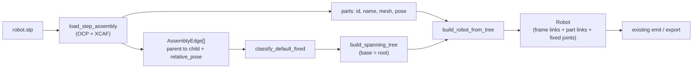

# STEP Assembly Import (`.stp` / `.step` → Robot) — Design

**Date:** 2026-06-13
**Status:** Approved (brainstorming complete, pending implementation plan)
**Related:** [[2026-04-26-cad-to-urdf-converter-design]] (core model + pipeline); builds on the existing `core/extract/` scaffolding (`AssemblyEdge`, `classify_default_fixed`, `build_spanning_tree`)

## Goal

Import a STEP CAD assembly and turn it into a multi-link `Robot`: read the named
part hierarchy and per-part poses, tessellate each part to a mesh, and assemble a
kinematic tree (all joints `fixed`, re-typed by the user afterward). This is the
v1.0 "real robot CAD in, ROS package out" milestone, replacing today's hard
rejection of `.step` / `.stp`.

## Background & feasibility (verified)

`pythonOCC-core` is conda-only and **not installable here** (no conda on the
system). Decision: use **OCP (`cadquery-ocp`)** — the same OCCT engine, but
pip-installable. Two feasibility spikes in `.venv` passed:

- **Tessellation:** `STEPControl_Reader` → `BRepMesh_IncrementalMesh` →
  `TopExp_Explorer(FACE)` → `BRep_Tool.Triangulation_s` → `tri.Node(i)` /
  `tri.Triangle(i).Get()` → `trimesh` (box round-trip: 12 faces, watertight,
  volume exact).
- **XCAF assembly:** `STEPCAFControl_Reader(SetNameMode=True)` → `TDocStd_Document`
  → `XCAFDoc_DocumentTool.ShapeTool_s` → `GetFreeShapes` / `IsAssembly_s` /
  `GetComponents_s` / `GetReferredShape_s` / `GetLocation_s` + `TDataStd_Name`
  yielded names, hierarchy, and poses for a nested `robot → [base, arm@z=10]`
  assembly. The same write API generates test fixtures.

The `extract/` pipeline is half-built: `AssemblyEdge → classify_default_fixed →
build_spanning_tree` exist and are tested; the **STEP→AssemblyEdge extractor** and
the **tree→Robot builder** are the missing ends this feature adds.

Pipeline: `STEP → load_step_assembly → classify_default_fixed →
build_spanning_tree(base=root) → build_robot_from_tree → Robot`.

## Decisions (locked during brainstorming)

| Decision | Choice |
|---|---|
| STEP engine | **OCP (`cadquery-ocp`, pip)**, lazy-imported in the parser; ships as a `[step]` extra. |
| Scope | **Full XCAF assembly tree** — named parts, hierarchy, poses → multi-link Robot. |
| Joint types | **All `fixed`** (`classify_default_fixed`); user re-types to revolute/prismatic later. |
| Assembly nodes | **Massless "frame" links** (faithful hierarchy). *Requires a core-model change — see below.* |
| Base link | The **root assembly node** (re-rootable later via `set_base_link`). |
| Units | Read into **meters** (OCC `xstep.cascade.unit = "M"`; fallback ×0.001 mm→m). |

### Forced addition — meshless "frame" links

Faithful hierarchy needs the sub-assembly nodes represented as links with **no
mesh** (otherwise the tree collapses to a flat star). The current `Link` requires
`visual_mesh_path` + `material_density > 0`, and `emit._emit_link` always writes a
`<visual>`/`<collision>`. So this feature must extend the model:

- `Link.visual_mesh_path` / `collision_mesh_path` become **optional** (`Path | None`);
  `material_density` / `material_name` optional when there is no mesh.
- `emit._emit_link` emits a bare `<link name=.../>` (no visual/collision/inertial)
  when there is no mesh — a valid URDF frame link.
- `viewport/widget._rebuild` already skips non-absolute/missing paths; guard `None`.
- `project/save.py` serializes `None` paths.

## Components

### 1. Core model + emitter — meshless frame links
As above: optional mesh/material on `Link`; emitter and project I/O handle the
meshless case. Small, isolated, with its own tests (frame link round-trips; URDF
has a bare `<link>` with no `<visual>`).

### 2. `core/parsers/step.py` (new, OCP, lazy import)
`load_step_assembly(path: Path) -> StepAssembly` where `StepAssembly` holds
`parts: list[StepPart]` (`id`, sanitized `name`, `mesh: trimesh.Trimesh | None`,
`is_leaf: bool`), `edges: list[AssemblyEdge]` (parent→child, `relative_pose`
child-relative-to-parent), and `root_id`.
- Walk XCAF from `GetFreeShapes`; recurse assemblies via `GetComponents_s`; map
  each component to its referred part label; `id` = label entry string,
  `name` = `TDataStd_Name` sanitized to a URDF-valid, de-duplicated name
  (anonymous → `part_N`); `relative_pose` from `GetLocation_s`.
- Leaf parts tessellated to a `trimesh` (verified API), in meters.
- Degenerate inputs: a single solid (no assembly) → one leaf under a synthetic
  root; a flat multi-solid file → parts under a synthetic root.
- `import OCP` lazily; a clean `ImportError`-derived message ("install `.[step]`")
  if absent.

### 3. `core/extract/build_robot.py` (new — the missing "Task 4.3")
`build_robot_from_tree(*, parts, tree, base_id, robot_name, mesh_dir, material) -> Robot`:
- Each tree node → `Link`: leaf parts get their tessellated mesh **written to
  `mesh_dir` as `<name>.stl`** (so `Link` has absolute visual/collision paths) +
  the default material; assembly nodes → meshless frame `Link`.
- Each `ClassifiedJoint` → `Joint(type="fixed", origin=relative_pose, axis=[1,0,0])`.
- Validates the result via the existing `Robot` constructor invariants.

### 4. Wiring (CLI + GUI + deps)
- **CLI** (`cli/main.py`): route `.step`/`.stp` to the STEP pipeline; remove the
  `STEP_NOT_SUPPORTED_MSG` rejection (keep a clean "install `.[step]`" message
  when OCP is absent).
- **GUI**: a `build_step_import_job` worker running the pipeline → `controller.replace`;
  enable the (currently disabled) **Import STEP** action with a `*.step *.stp`
  dialog; remove the STEP branch from `import_meshes._load_one`.
- **Deps/docs**: `[step]` extra = `cadquery-ocp>=7.7`; README (STEP now supported
  via the pip `[step]` extra) and a note in `environment.yml`.

## Data flow

## Error handling

- OCP not installed → a clear, actionable error pointing at `pip install -e ".[step]"`.
- Unreadable/empty STEP, or a part with no tessellable geometry → `ValueError`
  naming the file/part.
- Name collisions after sanitization → deterministic de-duplication (`name_2`, …).
- `build_spanning_tree` already raises `SpanningTreeError` for disconnected graphs;
  surfaced with context.

## Testing (TDD)

- Fixtures generated at test time with OCP (single solid, flat multi-solid, nested
  named assembly) — no binary fixtures committed.
- Unit: `load_step_assembly` (names, hierarchy, poses, units→meters, tessellation);
  `build_robot_from_tree` (frame vs mesh links, joint origins, mesh files written);
  meshless-frame-link model + emitter (bare `<link>`).
- Integration: `robot.stp → Robot → emit_urdf` produces a package whose links and
  fixed-joint origins match the assembly.
- All STEP tests guarded by `pytest.importorskip("OCP")` so the suite stays green
  where OCP is absent (OCP **is** installed here, so they run).

## Out of scope

Mate-based joint-type inference (revolute/prismatic from STEP mates); IGES;
per-face materials/colors from STEP; mesh decimation/LOD; reading assembly
metadata beyond name + pose.
